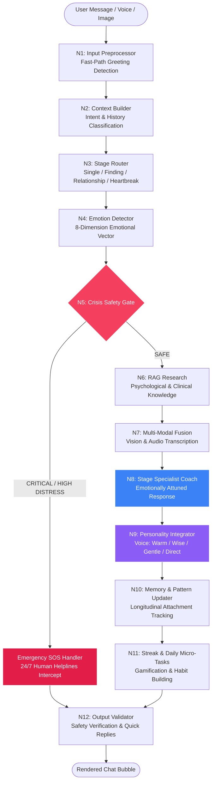

# 💙 LoveGuru AI — Master Relationship & Dating Intelligence Platform

<p align="center">
  
  
  
  
  
  
</p>

<p align="center">
  <strong>The world's most emotionally intelligent, culturally attuned AI relationship companion, dating coach, and heartbreak recovery guide.</strong>
</p>

---

## 🌟 Overview

**LoveGuru AI** is an end-to-end relationship intelligence application designed to support humans across every phase of modern love. Powered by **LangGraph**, **Groq LPU frontier models** (`openai/gpt-oss-120b` and `qwen/qwen3.8-27b`), and evidence-based psychological frameworks (Bowlby attachment theory, Gottman Method, and neurobiology of grief), LoveGuru AI delivers warm, natural, and hyper-personalized guidance.

---

## 🧠 12-Node Multi-Agent LangGraph Architecture

Every user interaction traverses an isolated, deterministic 12-node cognitive pipeline engineered for sub-second classification, deep emotional attunement, and uncompromising crisis safety:



---

## 🚀 The 4 Life Stages of Love

### 🟡 Stage 1: Single & Searching
- **Reality Check Partner Analysis**: Evaluates dream-partner wishlists for realism (0-100% score), highlighting healthy versus tension-filled expectations and explaining the psychological roots of user criteria.
- **Love Readiness Index**: 6-dimension assessment measuring emotional independence, healing from the past, self-love, and vulnerability.
- **6-Area Self-Improvement Roadmap**: Concrete milestones covering Emotional, Communication, Grooming, Confidence, Social, and Lifestyle dimensions.

### 🟢 Stage 2: Finding Love (Dating Coach)
- **Tactical Dating Advice**: Natural conversation openers, banter, and date debriefs.
- **Green & Red Flag Scanner**: Balanced analysis of prospective partners without rushing to extreme judgments.
- **Dating Profile & Screenshot Coaching**: Image and screenshot analysis providing 3 tailored response styles (**Warm**, **Witty**, or **Direct**).

### 🔵 Stage 3: In Relationship (Gottman Coach)
- **Four Horsemen Detection**: Identifies Criticism, Contempt, Defensiveness, and Stonewalling with immediate Gottman antidotes.
- **Gentle Startup Scripts**: Word-for-word templates transforming aggressive statements into vulnerable requests:  
  *`"I feel [emotion] about [situation], and I need [underlying need]."`*
- **Love Language Translation**: Unpacks differences in Words of Affirmation, Quality Time, Gifts, Acts of Service, and Physical Touch.
- **Relationship Health Dashboard**: Longitudinal check-in monitoring connection levels over time.

### 🔴 Stage 4: Heartbreak Recovery & Healing
- **Grief Weather Model**: Normalizes recovery as non-linear weather shifts (*Storm ⛈️ → Overcast ☁️ → Rain 🌧️ → Clearing ⛅ → Sun ☀️*).
- **15-Minute Urge Surfing Protocol**: Emergency delay protocol when tempted to break no-contact or message an ex.
- **Closure Letter Safe Vault**: A private sanctuary to write unsent letters to process closure.
- **Physical Survival Triad**: Daily check-ins tracking sleep, nutrition, and sunlight exposure during grief.

### 🆘 Certified Crisis & Safety Intercept
- Zero-tolerance deterministic keyword gate for self-harm or severe emotional despair.
- Bypasses advice generation and routes straight to 24/7 human crisis support (e.g., **iCall: 9152987821**, **Vandrevala Foundation**, **AASRA**, **Snehi**).

---

## 🛠️ Technology Stack

| Layer | Technologies |
| :--- | :--- |
| **Backend Framework** | Python 3.12, FastAPI, Pydantic v2 Settings |
| **Agentic Workflow** | LangGraph, LangChain Core |
| **LLM Inference** | Groq LPU (`openai/gpt-oss-120b`, `qwen/qwen3.8-27b`), Google Gemini Flash Fallback |
| **Database & ORM** | SQLAlchemy 2.0 Async, SQLite (`aiosqlite`) / PostgreSQL (Supabase ready) |
| **Vector DB / RAG** | ChromaDB with deterministic sentence embeddings |
| **Frontend Framework** | React 19, Vite 8, React Router v7 |
| **State & UI** | Zustand, Framer Motion, `react-markdown`, Lucide React |
| **Security** | JWT HS256 Authentication, Password Hashing, CORS Guards |

---

## 📁 Repository Structure

```
LoveGuru/
├── backend/
│   ├── agents/            # Specialist agent implementations
│   ├── config/            # Settings, database, and LLM factory
│   │   ├── llm_config.py  # Model tiering, whitelists & fallback handlers
│   │   ├── settings.py    # Multi-path .env loader & environment validation
│   │   └── database.py    # Async SQLAlchemy engine & session factory
│   ├── graph/             # 12-Node LangGraph pipeline & state definitions
│   │   ├── main_graph.py  # Master graph orchestration
│   │   └── graph_state.py # TypedDict state container
│   ├── models/            # SQLAlchemy database models (14 tables)
│   ├── prompts/           # Emotionally tuned stage & intake prompts
│   ├── rag/               # Vector retriever & embeddings
│   ├── routers/           # FastAPI modular API routes
│   │   ├── auth_router.py
│   │   ├── chat_router.py
│   │   ├── stage1_router.py .. stage4_router.py
│   │   └── emergency_router.py
│   ├── services/          # Business logic & LLM JSON parsers
│   ├── tests/             # End-to-end smoke tests
│   ├── tools/             # Image analyzer & voice processor
│   └── main.py            # Application lifespan & FastAPI factory
├── frontend/
│   ├── src/
│   │   ├── api/           # Axios instance & API client endpoints
│   │   ├── components/    # Common UI widgets, Navbar, Modals
│   │   ├── pages/         # 14 Full pages (Chat, Stages, Auth, Profile...)
│   │   ├── store/         # Zustand global state (Auth, Chat stores)
│   │   └── App.jsx        # Route definitions & protected route guards
│   ├── package.json       # React 19 dependencies & scripts
│   └── vite.config.js     # Vite configuration
├── .env                   # Root environment configuration
└── README.md              # Project documentation
```

---

## ⚡ Quick Start Guide

### Prerequisites
- **Python**: 3.12+
- **Node.js**: 18+ & npm
- **Groq API Key**: Free API key from [console.groq.com](https://console.groq.com)

---

### Step 1: Environment Setup

Clone the repository and copy the environment configuration:

```bash
git clone https://github.com/your-username/LoveGuru.git
cd LoveGuru
```

Create or edit your `.env` file in the root (and `backend/.env`):

```env
APP_NAME="LoveGuru AI"
APP_ENV=development
DEBUG=True

# Database (SQLite default for local development)
DATABASE_URL="sqlite+aiosqlite:///./loveguru.db"

# Groq AI Models (Active frontier models)
GROQ_API_KEY="gsk_your_groq_api_key_here"
GROQ_PRIMARY_MODEL="openai/gpt-oss-120b"
GROQ_FAST_MODEL="qwen/qwen3.8-27b"

# Gemini Vision (Optional fallback for photos)
GEMINI_API_KEY="AIza_your_gemini_key_here"
GEMINI_MODEL="gemini-2.0-flash"

# Security
JWT_SECRET_KEY="loveguru-jwt-secret-key-development-secure-32chars"
JWT_ALGORITHM="HS256"
```

---

### Step 2: Start the Backend Server

```powershell
# Navigate to backend
cd backend

# Install dependencies
pip install -r requirements.txt

# Run the FastAPI server
python -m uvicorn main:app --reload --port 8000
```

*When started, you should see:*  
`🤖 LoveGuru AI — LLM Status`  
`   Groq  : ✅ ACTIVE | model=openai/gpt-oss-120b`  
`   Mode  : REAL_AI`

API Interactive Documentation will be available at `http://localhost:8000/docs`.

---

### Step 3: Start the Frontend Application

Open a second terminal window:

```powershell
# Navigate to frontend
cd frontend

# Install packages
npm install

# Start Vite development server
npm run dev
```

Visit **`http://localhost:5173`** in your browser.

---

## 🧪 Running Verification & Tests

To execute the automated end-to-end smoke test covering Authentication, Chat, Crisis routing, and Stages 1–4:

```powershell
python backend/tests/_smoke_run.py
```

To verify the frontend production build:

```powershell
npm --prefix frontend run build
```

---

## 📡 Core API Reference

| Endpoint | Method | Description |
| :--- | :---: | :--- |
| `/api/v1/auth/register` | `POST` | Create a new account with email & password |
| `/api/v1/auth/login` | `POST` | Authenticate and obtain JWT access tokens |
| `/api/v1/auth/onboarding` | `POST` | Save stage, attachment style & personality preferences |
| `/api/v1/chat/text` | `POST` | Execute 12-node LangGraph chat with multi-turn memory |
| `/api/v1/chat/voice` | `POST` | Voice note audio transcription & response |
| `/api/v1/chat/image` | `POST` | Upload screenshot or photo for dating/grooming coaching |
| `/api/v1/stage1/partner-description` | `POST` | Reality Check analysis & realism score calculation |
| `/api/v1/stage2/red-green-flags` | `POST` | Multi-trait flag detector for dating prospects |
| `/api/v1/stage3/conflict-script` | `POST` | Gottman Gentle Startup script generator |
| `/api/v1/stage4/urge-surfing` | `POST` | 15-minute urge surfing distraction exercise |
| `/api/v1/progress/checkin` | `POST` | Daily emotional check-in & streak increment |
| `/api/v1/emergency/sos-trigger` | `POST` | Instant emergency crisis logging & helpline dispatch |

---

## 🛡️ Privacy, Ethical Boundaries & Safety

- **Zero Clinical Claims**: LoveGuru AI is a supportive emotional companion and educational relationship tool. It does not provide clinical therapy, medical diagnosis, or legal advice.
- **Safety Protocol**: Any explicit mention of self-harm triggers an unblockable SOS screen connecting users with trained human crisis counselors.
- **Data Confidentiality**: Conversations are encrypted and private to the user account.

---

## 📄 License

Distributed under the **MIT License**. See `LICENSE` for details.

<p align="center">
  Made with 💙 for every heart navigating modern love.
</p>
